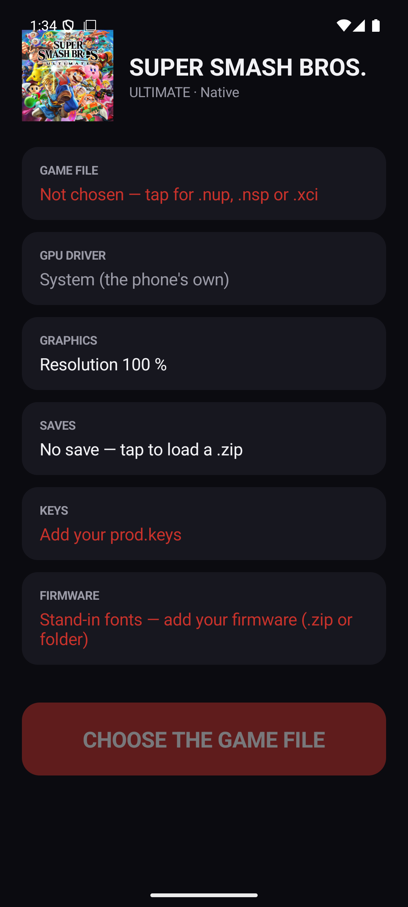

# Smash Ultimate Native



**Super Smash Bros. Ultimate** on an Android phone: a standalone Android app that plays Super Smash Bros. Ultimate (13.0.5, 52 DLC) on a Snapdragon phone, built on the Peanuts Native runtime.

This repository holds the app's own screen, its icon and the small hooks it adds to
the runtime. The emulator itself is not here: the app is built on top of
[Peanuts Native](https://github.com/igawa6/peanuts-native) (MIT; the Android host
is GPL-3.0-or-later, see [NOTICE](NOTICE)).

## What it does

- **One screen, one button.** The app's launcher has the game file, the update, the
  DLC, the GPU driver, the picture scale, the saves, and the console's keys and
  firmware. No emulator menus.
- **Builds the game file in the app.** `GAME FILE` takes the game's own
  `.nsp`/`.xci` (or a ready `.nup`), `DLC` takes any number of add-on files, and
  `BUILD GAME FILE` merges them into one `.nup` with the importer that ships in
  the APK. Update 13.0.5 (v2031616) is required and checked; the 52 DLC packs are added in one go.
- **Your keys and firmware stay yours.** The APK carries no `prod.keys` and no
  console font: `KEYS` takes your `prod.keys` and `FIRMWARE` takes your firmware
  folder or `.zip` (the NCAs flat inside), which the importer reads into the
  app's fonts folder.
- **GPU driver.** Mesa Turnip is picked automatically when it is installed in
  `files/gpu_drivers/` (the app's `GPU DRIVER` card installs a driver zip and lets
  you go back to the phone's own).
- **Saves** export and import as a zip.

## Requirements

- A phone with Android 13+ and 8 GB of RAM or more (a Snapdragon 8 Gen 2/3 class
  device is what it was made for).
- **Your own copy of the game** (a dump of the card you own) and, for a build from
  `.nsp`/`.xci`, your console's `prod.keys`.
- No game data is included in this repository or in its releases.

## Build

The app is an overlay on Peanuts Native: the script clones the pinned release,
copies the app's files in and applies the hooks patch.

```sh
./apply.sh                 # clones upstream at v0.1.7-1, copies the overlay, applies the patch
cd peanuts-native/android/app
JAVA_HOME=/path/to/jdk17 ANDROID_HOME=/path/to/android-sdk \
  ./gradlew apk -PnxApp=peanuts -PnxAppId=smash -PnxLabel="Smash Ultimate Native" \
  -PnxGames=01006A800016E000 -PnxPackEngine=fake
# android/app/out/nxnative-android-peanuts.apk
```

`apply.sh` needs `git`, a JDK 17 and the Android SDK (build-tools, NDK 28.2).
The first build takes a few minutes (the native host is compiled from source).

### The game data pack

The `.nup` is the game; the **pack** is the code and shader data the runtime needs
next to it (`files/packs/01006A800016E000/`). It is built from the game on a computer
or on the phone with Peanuts Native's **Prepare**, and it is not distributed here
(it holds the game's own translated shaders). Put your pack in
`files/packs/01006A800016E000/` (or in `assets/smash/pack.zip` of your own build,
which the app copies on first start).

## Tested on

Samsung Galaxy S24+ (Snapdragon 8 Gen 3, Adreno 750), Android 16: 60 fps with Mesa
Turnip. The phone's own Adreno driver runs the menus but loses the device at some
scene changes, which is why the app prefers Turnip.

## Support

This app is free and will stay free. If it is useful to you, you can buy me a
coffee:

- Ko-fi: https://ko-fi.com/hanxlnative

## Credits

- [Peanuts Native](https://github.com/igawa6/peanuts-native) by seedds and its
  contributors: the runtime this app is built on (MIT; the Android host is
  GPL-3.0-or-later — see [NOTICE](NOTICE)).
- Mesa Turnip, Noto Sans (SIL OFL) and Droid Sans Fallback (Apache 2.0) for the
  pieces shipped with the app.
- Not affiliated with Nintendo, Bandai Namco or Sora Ltd. The game's names and
  cover art belong to their owners; this app ships neither.

## License

The files in **this repository** (the launcher screen, the icon, the hooks patch
and the scripts) are MIT, see [LICENSE](LICENSE). An APK built with them also
contains Peanuts Native's Android host, so **the APK as a whole is
GPL-3.0-or-later**; whoever passes it on must offer its complete source.
